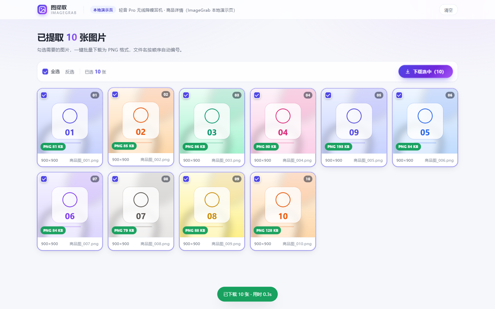

# 图提取 ImageGrab

> Chrome 扩展：在淘宝 / 天猫、京东、拼多多商家版的商品详情页一键提取全部图片，集中预览、自由勾选，批量下载为 PNG。


官网（GitHub Pages）：<https://againqw.github.io/imagegrab/>



## 解决什么问题

电商详情页的商品图分散在主图、轮播、详情长图和背景图里，地址还常被压成 `xxx.jpg_430x430q90.jpg` 这类缩略图，格式混杂（JPG / WebP / PNG）。手动右键保存既慢又容易漏，做完还得逐张改名、转格式。

插件把这件事压缩成一次点击：**提取 → 预览 → 勾选 → 批量下载 PNG**。

## 功能特性

| 功能 | 说明 |
| --- | --- |
| 一键提取 | 扫描 ``、`currentSrc`、`srcset`、`data-src` / `data-lazy-src` / `data-original` 等懒加载属性，以及 `background-image` |
| 还原原图 | 阿里 CDN 的 `_430x430q90` 后缀、京东的 `/s450x450_jfs/` 缩略路径会被还原为原图地址 |
| 智能过滤 | URL 特征（logo/icon/placeholder/1x1…）+ 实际像素双重过滤，小于 100×100 直接丢弃 |
| 集中预览 | 新标签页网格展示，含缩略图、真实尺寸、`商品图_001.png` 序号文件名 |
| 自由勾选 | 全选 / 反选 / 单张点选，已选数量实时显示 |
| 统一 PNG | 在 Service Worker 内用 `createImageBitmap` + `OffscreenCanvas` 重新编码，JPEG/WebP 也能输出 PNG，透明通道铺白底不发黑 |
| 批量下载 | `chrome.downloads.download` 按序号命名保存，进度条 + 结果提示，单张失败自动回退原格式 |
| 精准注入 | 仅在三个平台的商品详情页注入悬浮按钮，其他页面不出现 |

## 安装

1. 下载本仓库并解压：<https://github.com/Againqw/imagegrab/archive/refs/heads/main.zip>
2. 打开 Chrome，地址栏输入 `chrome://extensions` 回车
3. 打开右上角「开发者模式」
4. 点击「加载已解压的扩展程序」，选择解压后的文件夹

> 需要 Chrome 109 及以上（Manifest V3 + `chrome.runtime.getContexts`）。

## 使用

打开任意商品详情页 → 右下角出现「获取图片」→ 点击 → 新标签页展示全部图片 → 勾选 → 「下载选中」。

首次试用可以打开本地演示页：先启动任意静态服务器，访问
`http://localhost:8123/demo/shop.html?imagegrab-demo=1`（带参数才会注入按钮，模拟真实站点）。

## 本地验证

```bash
npm install          # 仅需 playwright-core
npm test             # 端到端测试，约 10 秒
```

测试用真实 Chrome 加载扩展，覆盖：按钮注入 → 提取 10 张图 → 预览页渲染 → 批量下载 → 落盘文件名与 PNG 格式校验 → 非详情页不注入。截图输出到 `screenshots/`。

## 项目结构

```
imagegrab/
├── manifest.json          # MV3 清单：权限、内容脚本、Service Worker
├── content.js             # 页面识别 + 悬浮按钮 + 图片提取与尺寸探测
├── content.css            # 悬浮按钮 / Toast 样式（隔离命名，避免污染页面）
├── background.js          # Service Worker：存储、打开预览页、PNG 转换与下载
├── gallery.html           # 预览页结构
├── gallery.js             # 预览页逻辑：渲染、勾选、批量下载、进度
├── gallery.css            # 预览页样式
├── icons/                 # 16 / 48 / 128 扩展图标
├── demo/                  # 本地演示详情页（含 10 张测试图，覆盖懒加载/背景图/小图）
├── docs/                  # 官网静态站点（GitHub Pages 发布目录）
│   ├── index.html
│   ├── css/style.css
│   ├── js/main.js
│   └── assets/
├── screenshots/           # 端到端测试产出的真实截图
└── tools/
    ├── e2e.mjs            # Playwright 端到端测试
    └── gen_assets.py      # 生成图标与演示图片
```

## 技术实现要点

**消息流**：`content.js` 提取完成后 `chrome.runtime.sendMessage({type:'EXTRACT_DONE'})` → `background.js` 写入 `chrome.storage.local` 并打开 `gallery.html` → 预览页读取同一份数据渲染，下载时逐张发 `DOWNLOAD_ONE` 回到 Service Worker。

**为什么在 Service Worker 里转 PNG**：图片 CDN 通常校验 Referer 或缺少 CORS 头，页面内 canvas 会污染（tainted）。扩展声明了 `host_permissions`，Service Worker 里的 `fetch` 不受同源限制，拿到 Blob 后解码、绘制、`convertToBlob({type:'image/png'})`，绕开跨域限制。

**为什么下载走 data URL**：MV3 的 Service Worker 里 `URL.createObjectURL` 不可用（已从 SW 规范移除），所以统一转 base64 data URL 交给 `chrome.downloads`；实测 20MB 的 PNG（base64 约 26MB）也能正常完成。

**懒加载处理**：扫描先行、探测后置。先把候选 URL 收集齐，再用 `new Image()` 按 6 并发实际加载并读取 `naturalWidth/naturalHeight`，既能把懒加载图"逼"出来，也顺带完成尺寸过滤。

## 支持的平台

| 平台 | 域名 | 详情页判定 |
| --- | --- | --- |
| 淘宝 / 天猫 | `*.taobao.com`、`*.tmall.com` | `/item.htm`、`/item/`、`detail.tmall.com/item` |
| 京东 | `item.jd.com`、`item.m.jd.com` | `/<id>.html`、`/product/<id>` |
| 拼多多商家版 | `*.pinduoduo.com`、`*.yangkeduo.com` | `goods*.html`、`goods_id=` |

## 隐私

所有处理都在本地浏览器内完成，不上传图片、不上报数据，仅使用扩展运行必需的 `activeTab` / `scripting` / `downloads` / `storage` 权限。

## License

[MIT](LICENSE)
